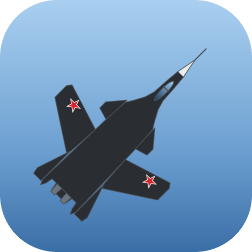

<p align="center">
  
</p>

<h1 align="center">Berkut</h1>

<p align="center">
  <b>Linux phone and desktop environments, running on an iPhone.</b>
</p>

<p align="center">
  <a href="https://github.com/vgs499p/berkut/releases/latest"></a>
  
  
  
  <a href="LICENSE"></a>
</p>

## Download

Get `Berkut.ipa` and `Berkut.entitlements` from the
[latest release](https://github.com/vgs499p/berkut/releases/latest),
sideload them (see [Installing](#installing)), then pick a system in the app:

| | Plasma Mobile | Phosh | Plasma Desktop |
|---|---|---|---|
| Arch Linux ARM | yes | yes | yes |
| Fedora | yes | yes | yes |
| Ubuntu 26.04 LTS | no | yes | yes |

The systems are experimental. On an iPhone 16e, Fedora with Plasma Desktop
and Arch with Phosh have run; Phosh was much faster than GNOME. The rest are
untested.

- you choose the username, password and computer name at install time;
- everything written in a system persists, each on its own storage disk;
- the iPhone's battery shows in the guest, and NetworkManager the connection;
- `berkut-logs` and `berkut-reset` for when things go wrong.

Without a JIT the guest runs on an interpreter: heavy apps such as Firefox
are slow.

## About

Berkut is a build of
[Kernarium](https://github.com/imxieyi/Kernarium): a User-mode Linux kernel
compiled to native arm64 and run inside an iOS app, with guest programs on an
interpreter (or a JIT under StikDebug) and graphics through Virgl, Zink and
KosmicKrisp to Metal.

This repository holds only what Berkut adds. A build clones upstream
Kernarium at the commit in `upstream.env` and applies `patches/`.

## Layout

```text
patches/        Berkut's commits on upstream Kernarium (git am)
branding/       name, bundle identifier, icons (make-icon.py), logo, apply-branding.sh
images/         the installer's systems, built by GitHub Actions
image/          the older single Arch image, to bundle into an IPA
bootbase/       static BusyBox/e2fsprogs boot ramdisk recipe
scripts/        setup and build steps, in order below
Berkut.entitlements   the two memory entitlements the app needs
```

## Requirements

- An Apple silicon Mac with Xcode and the iOS SDK (the app targets iOS 27).
- Homebrew: `llvm`, `lld`, `make` (gmake), `meson`, `ninja`, `cmake`,
  `pkg-config`, `autoconf`, `automake`, `zstd`, `librsvg`, `imagemagick`.
- Apple's `container` CLI for the arm64 Linux steps
  (`container system start --enable-kernel-install` once).
- About 60 GB free for the build volume.

## Build

```sh
scripts/setup.sh            # case-sensitive volume, upstream clone, patches
scripts/build-kernels.sh    # Linux and Android UML kernels (~45 min)
scripts/build-boot-base.sh  # boot ramdisk, recorded in its descriptor
scripts/build-app.sh        # iOS dependencies, runtimes, frameworks, app
scripts/make-ipa.sh "$PWD/Berkut.ipa"
```

The IPA bundles no system. `.github/workflows/images.yml` builds those and
publishes them to the `images-1` pre-release, which the app downloads from.

`BERKUT_BUILD_ROOT` moves the build volume (default `/Volumes/BerkutBuild`).
Everything there is generated and can be thrown away.

## Installing

The IPA is unsigned apart from an ad-hoc signature that carries the
entitlements. With Plume Impactor and a free Apple ID:

- set **Identifier** to an App ID the account already has, to stay under
  Apple's 10 App IDs per 7 days;
- enable **Only Register Main Bundle** and add `Berkut.entitlements`.

On first launch the app opens **Install a system** (also the download button
beside the guest). It downloads the system, verifies it, and creates your
account at the first start; close and reopen Berkut to boot it. Pick between
installed systems in Emulator settings, under Storage. The `root` password is
`root`.

Each system boots its image read-only beneath its own writable overlay disk
in the app's `Library/Guest` (sparse, excluded from iCloud backups). Files,
installed packages and settings are kept across launches and app updates.
Raising the overlay size in Emulator settings grows the disk at the next
launch; it never shrinks. As root, `berkut-reset` discards a system's changes
at the next launch. Reinstalling a system also erases its disk, and deleting
the app deletes everything.

Updating from 1.0 keeps its Arch system (accounts `uml`/`uml`, `root`/`root`,
`alarm`/`alarm`) and that system's files.

## Branding

Edit `branding/branding.env`, or redraw the icon with `branding/make-icon.py` and render the PNGs (1024×1024: light, dark,
tinted), then run `branding/apply-branding.sh` on the checkout and
regenerate patch 0003 (`git format-patch`).

## Notes from the first build

- Apple clang lacks Linux 6.18's `__counted_by` support; the kernel builds
  with Homebrew LLVM.
- The kernel's release string carries the local replay's commit, so
  `build-kernels.sh` writes the built release into the accepted descriptors.
- Upstream never published the `starter-20260928-boot-base-r1` ramdisk;
  `bootbase/` rebuilds an equivalent that passes `verify_base.py`.
- The Android runtime is built only because packaging and the Xcode project
  require it; Berkut never boots Android.
- Arch's SDDM needs `DisplayServer=wayland` (the image has no X server), and
  the Kernarium input devices need the udev rules from upstream's
  postmarketOS setup.
- Stock Arch Mesa reaches the host GPU through Virgl (`virgl (zink ...
  (Apple A18 GPU))`); do not force `MESA_LOADER_DRIVER_OVERRIDE=zink`, which
  falls back to llvmpipe.
- Without JIT everything runs on the interpreter, so Plasma is slow. The
  image turns off animations, effects, Baloo and session restore.
- Do not build the image with `mkfs.erofs -T0`: SDDM ignores configuration
  files dated at the epoch and falls back to X11 without autologin.
- Patch 0005 gives the Linux guest the iPhone's battery (the kernel's
  Kernarium Virtio battery driver, upstream Android-only); the mainline
  kernel is published as release `ca2`. NetworkManager replaces
  systemd-networkd so Plasma's indicator sees the (wired) SLiRP link.
- Plasma's on-screen keyboard can mangle hidden password prompts; `uml`'s
  password is `uml`. As root, `berkut-logs` shows why a session ended and
  `berkut-session plasma|plasma-mobile` switches the desktop.
- Berkut was called Burrow before guest storage persisted. Signed with the
  same Plume Identifier, Berkut installs over Burrow as an update.

## License

GPL-2.0-or-later, as upstream Kernarium (`LICENSE`). Anyone you give the IPA
to is entitled to its source: this repository plus upstream at the pinned
commit.

The downloadable systems are built from their distributions' unmodified
packages (the lists are in `images/distros/`), each under its own license,
with sources from [Arch Linux ARM](https://github.com/archlinuxarm/PKGBUILDs)
and [Arch Linux](https://gitlab.archlinux.org/archlinux/packaging/packages),
[Fedora](https://src.fedoraproject.org/) and
[Ubuntu](https://launchpad.net/ubuntu). The 1.0 IPA bundled an Arch Linux ARM
image from the same Arch sources.

Berkut is an independent build and is not affiliated with Kernarium's
author, Arch Linux ARM, Fedora, Ubuntu, KDE, GNOME or Sukhoi.
